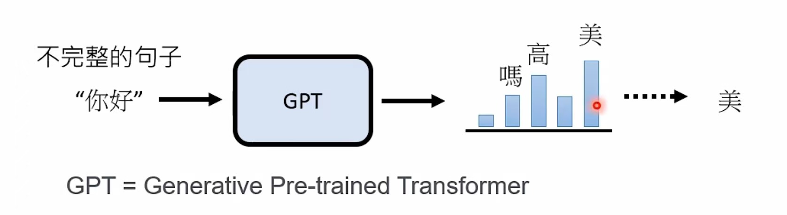
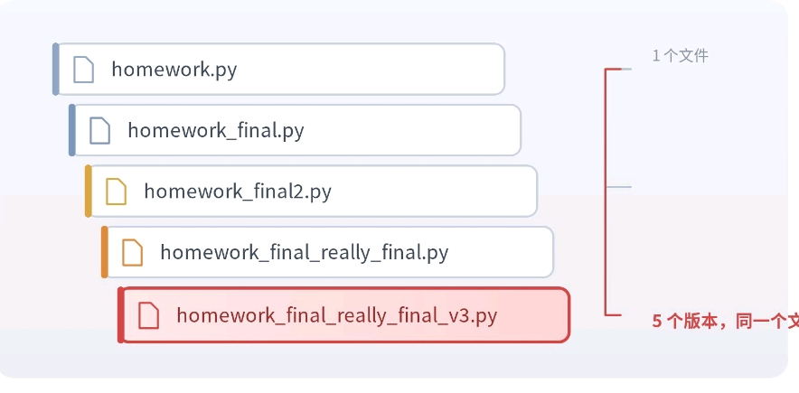
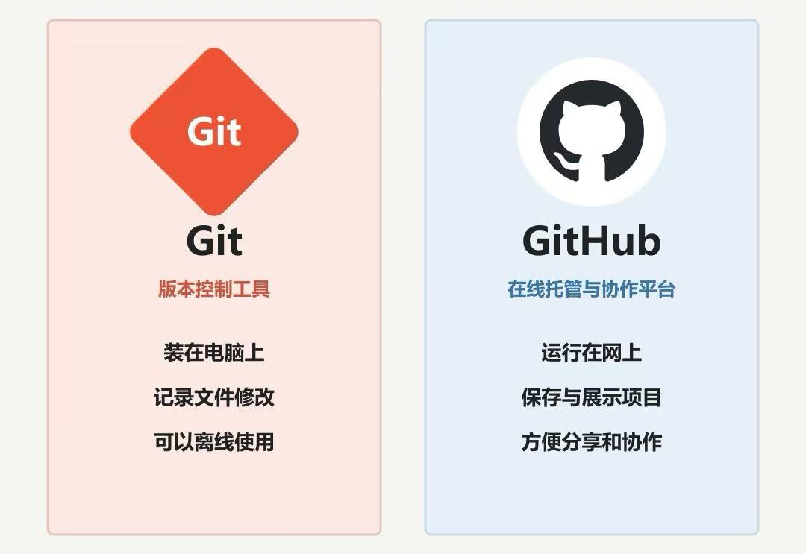
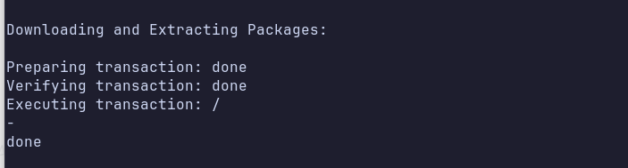

# EmbodiedAI Week 2: Vibe Coding

# 一、什么是 Coding？

## 1\.1 什么是 Code

**假如我现在想让我的电脑拍一张照，我该怎么告诉它？**

人说一句"拍一下前面的桌子"就够了；但计算机需要通过“程序语言”，把“拍照”这件事拆成具体、精确、可执行的步骤。例如：

```Plain Text
打开电脑前置摄像头，得到一个可操作的摄像头对象“camera”
从摄像头对象“camera”中读取一帧图像，记为变量“image”
将变量 image 保存到 D 盘文件 photo.jpg
结束拍摄，释放摄像头
```


**代码，就是用能够执行的形式，把这些步骤写下来；编写代码这件事就叫 Coding，也就是编程。**

同一个程序可以用很多种不同的编程语言来写，例如 Python、C\+\+、Java……，不同语言的写法不同，也更适合不同类型的任务。**本课程主要用 Python 语言**。

一个简单的 Python code 例子：

```Python
a = 10
b = 20
temp = a
a = b
b = temp
```


## 1\.2 什么是 Library

我写好的代码功能，能否被打包分享出去，让其他人能够直接搬过去用？

—— **Library（库）就是一组已经写好的、可以被其他程序直接调用的代码功能。**
 对于 Python 而言，我们通常可以用一个叫 **pip** 的工具来安装别人发布的第三方库。


我们可以通过运行这个命令来安装 OpenCV 库，它包含了常用的图像采集、处理和保存的功能实现，可以让我们直接调用：

```Python
pip install opencv-python
```


现在，我们就可以真正让电脑完成一次拍照了：

```python
import cv2                          # 将 OpenCV 库导入我们自己的 python 代码

camera = cv2.VideoCapture(0)        # 使用 OpenCV 打开默认摄像头
success, image = camera.read()      # 从摄像头读取一帧图像
cv2.imwrite("photo.jpg", image)     # 把图像保存为 photo.jpg
camera.release()                    # 关闭摄像头，释放资源
```


## 1\.3 代码的基本结构

如果我们想完成稍微复杂一些的功能，例如：

> 打开摄像头 → 拍照保存，保存成功则输出“saved”\+文件名，失败则输出“failed” → 等三秒 → 再拍照 → 重复三次后输出“Done”
> 
> 

我们怎么通过代码来描述这些逻辑功能？

```Python
import cv2                 # 导入 OpenCV 库，用于控制摄像头和处理图像
import time                # 导入 time 库，用于控制等待时间

camera = cv2.VideoCapture(0)   # 打开电脑默认摄像头
if not camera.isOpened():      # 检查摄像头是否成功打开
    print("Failed to open camera")   # 如果失败，输出错误信息
else:
    print("Camera opened")     # 如果成功，输出提示信息

for i in range(3):             # 循环 3 次，拍摄 3 张照片
    success, frame = camera.read()  # 从摄像头读取一张当前画面
    if success:                # 判断是否成功获取图像
        filename = f"photo_{i+1}.jpg"   # 创建图片文件名
        cv2.imwrite(filename, frame)    # 将图片保存到文件
        print("saved", filename)        # 输出保存成功和文件名
    else:
        print("failed")       # 如果拍摄失败，输出失败信息
    time.sleep(3)             # 等待 3 秒后继续下一次拍摄

camera.release()              # 释放摄像头资源
print("Done")                 # 三次拍摄完成后输出 Done
```


# 二、不会写代码怎么办？

—— 用 AI。准确来说，是用**大语言模型（Large Language Model，LLM）**。


## 2\.1 什么是大语言模型（LLM）？

—— 简而言之，大语言模型是一个用“下一  token  预测”的训练范式，在海量文本语料库上训练出来、具有海量参数的深度学习模型。所谓“下一 token 预测”，我们可以用文字接龙来理解。




因此，在大模型基于我们的需求帮我们生成代码时，它其实就是在不断地进行“下一个 token 预测”，这个 token 涵盖所有文本，包括文字和代码部分。而我们给大模型的输入，就叫做“提示词”（prompt）。


## 2\.2 写好 Prompt

大模型能否给出一个令你满意的回答 or 代码实现，很大程度取决于你能否描述清楚你的需求和背景信息。

这里给一个例子：

> 我刚开始学编程，我想用电脑摄像头模拟机器人的眼睛帮我拍照。
> 
> 我的笔记本电脑的操作系统是【Windows / MacOS / Linux】，摄像头是【电脑自带／USB】。
> 
> 我希望用 python 代码实现这个功能：打开摄像头 → 拍照保存，保存成功则输出“saved”\+文件名，失败则输出“failed” → 等三秒 → 再拍照 → 重复三次后输出“Done”
> 
> 请告诉我实现这个功能应该怎么做，例如我应该提前准备或下载什么、我应该如何运行这段代码、运行后我应该如何检查它是否顺利运行。
> 
> 


还有一些 prompt 的邪修用法，例如在你需要快速弄懂一篇英文论文的时候：


\(素材来自小红书，“百岁太奶读文献法”\)


## 2\.3 我们可以继续迭代

> 请你基于以上这段代码继续修改，这次请你打开一个窗口，长期显示摄像头拍到的内容，然后只在我按下键盘上的 C 键的时候，会自动拍照并保存为 jpg 图片，并以拍照时间作为图片的文件名。当我按下 Q 键的时候，就退出。
> 
> 


**这就是 Vibe Coding**

**说清楚需求 → 让 AI 写代码 → 运行 → 看结果 → 反馈（例如遇到的 bug，或者增加新的功能）**


# 三、我看不懂 AI 写的代码怎么办？


这里需要介绍一个概念，叫“注释”。它不会被用作计算机的输入，它的存在只是为了让读代码的人能够更快地理解到写代码的人的意图。实际上在前面的代码中，我们就已经大量用上了“注释”。

```python
import cv2                       # 在自己的代码中引入我们刚才下载的 OpenCV 库

camera = cv2.VideoCapture(0)     # 调用这个库里写好的 VideoCapture 功能
success, image = camera.read()   # 调用 OpenCV 专门给相机定义的类的拍摄功能
cv2.imwrite("photo.jpg", image)  # 调用 OpenCV 保存图像的功能
camera.release()
```


因此，让大模型写注释是一个帮你理解它写的代码的好途径：

> 1. 请告诉我整个程序的数据从哪里来、经过什么处理步骤、最后去了哪里。
> 
> 2. 请给每一行代码添加浅显易懂的注释，并逐段解释代码，说清楚每一段解决什么问题。
> 
> 3. 对重要的 API，告诉我它属于哪个代码库，功能是什么。
> 
> 4. 解释这个 API 背后调用了什么更底层的软件或硬件能力。
> 
> 5. 告诉我如果删掉这一行会发生什么。
> 
> 6. 最后问我几个问题，检查我是否真的理解了。
> 
> 7. ……
> 
> 


# 四、AI 能直接帮我改项目吗？

**每次做代码开发，都要从零开始把我已经写好的代码告诉 AI，然后复制粘贴它给我写的代码，太麻烦了。**

**能不能让 AI 直接走进我的电脑，让它自己查看我已经写好的项目，并且在上面增添和修改？**

可以用**编程智能体（Coding Agent）**，它能在权限内自己看文件、改代码、跑命令。常见的编程智能体就包括 CodeX、Claude Code 等等。


## 4\.1 它和聊天有什么不同？

聊天模式要你来回搬运：复制代码给 AI → 贴回项目 → 运行 → 复制报错。

智能体自己完成这些来回，但它看不到你的摄像头，**照片对不对仍要你亲自确认**。


## 4\.2 Code Agent：直接把你电脑上的目录当做上下文


# 五、代码改坏了，怎么办？


**昨天还能拍照，今天咔咔一通改，改完发现不能用了，还怎么也解决不了，能回到昨天吗？**

提前存好版本就容易多了。**Git** 记录代码变化，把项目存成一个个"存档点"。

## 5\.1 复制"最终版"文件夹不行吗？

文件名变成一堆"最终版\_v2\_真的最终"之后，根本记不住哪版能用：



Git 一次记录改动涉及的所有文件，并附一句话说明。


## 5\.2 Git 和 GitHub 是一回事吗？



- **Git：**本地版本管理工具，历史存在自己电脑上；

- **GitHub：**在线托管、分享和协作的平台。

今天先学会本地存档。一次 **commit** 才是一次明确的版本。


## 5\.3 用 Git 完成代码存档

```bash
git init                    # 在当前文件夹中创建一个 Git 仓库
git status                  # 查看当前 Git 仓库的状态：哪些文件被修改、哪些还没提交
git add camera.py           # 把 camera.py 的当前版本加入“暂存区”，准备提交
git commit -m "拍照功能正常"  # 创建一次提交，并给这次提交写说明
git log --oneline           # 用简洁的一行格式查看历史提交记录
```

init 建仓库（一次）、status 看改动、add 选文件、commit 存档、log 查历史。


## 5\.4 真改坏了怎么退？

只丢弃某文件**未提交**的练习改动时：

```bash
git diff -- camera.py
git restore -- camera.py
```

restore 会丢掉该文件未暂存的改动，别用它处理还想保留的工作。情况复杂就这样问 AI：

> 请先看 git status 和 git diff，说明哪些没提交、哪些提交了，如何保留我现在的工作；给出恢复方案并解释影响，先别执行会丢改动的命令。
> 
> 


# 六、课后作业

根据 so\-arm 101 的官方仓库（lerobot）和文档，在本地完成环境配置（虽然这句话说的有些模糊，但你的 AI 应该能听懂）：

- https://github\.com/huggingface/lerobot（国内可访问的镜像站 https://gitee\.com/mirrors/lerobot）

- https://huggingface\.co/docs/lerobot/main/en/installation


如何验证Lerobot库安装成功?




若想继续验证，则可

```Plain Text
python -c "import lerobot; print('LeRobot import OK'); print(lerobot.**file**)"
```


**作业要求**：

1. 和你的 LLM 一起阅读 lerobot 仓库，理解它包含哪些模块、每个模块能够完成什么功能、完成这些功能的原理是什么、未来可以怎么使用、使用的时候在我们的电脑里会发生什么。用百岁老奶能够看懂的语言说清楚

**提交链接**：http://inbox\.weiyun\.com/l0h3i7pC

**请大家用“姓名\-学号”给提交的 Markdown 文件命名**

---


# 下次课前的准备

从以下链接购买机械臂的零件：

|**名称**|**购买链接**|价格 ￥|
|---|---|---|
|摄像头（每组 1 个）|https://e\.tb\.cn/h\.8HMSjkgQ6KSaA4V?tk=3g7ATRuoyuz|48|
|驱动板（每组 1 个）|https://e\.tb\.cn/h\.8HMkvNR34Rpm74S?tk=ISKPTRuHIlp|24|
|3D 打印件（每组 1 套）|沟通中|沟通中|
|舵机（每组 6 个）|沟通中|沟通中|

