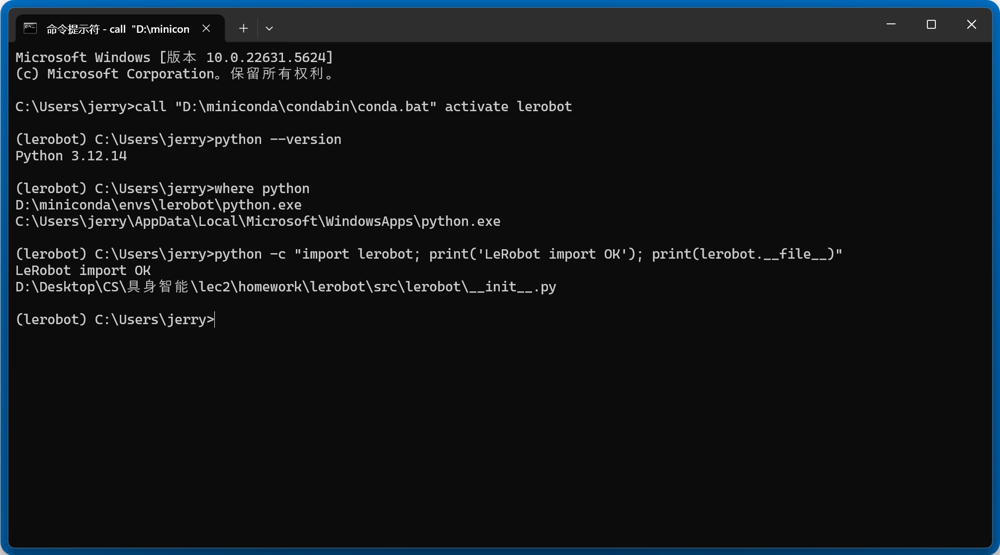

# LeRobot 环境配置与仓库阅读

姓名：刘正扬　　学号：23300180017

## 0. 本地安装验证

已按照作业要求验证。

## 1. 它是什么？

LeRobot 是一套帮助我们连接机器人、记录操作、训练模型，再用模型控制机器人的开源软件工具。

## 2. 它包含哪些模块？

一些核心模块可以按工作大体分成四部分：

| 工作 | 主要模块 |
| --- | --- |
| 获取信息和操作硬件 | `cameras`、`teleoperators`、`robots`、`motors` |
| 保存和整理数据 | `datasets`、`processor`、`transforms` |
| 模型训练 | `policies`、`optim` |
| 组织运行和执行任务 | `scripts`、`configs`、`rollout` |

除此以外，仓库还有仿真环境 `envs`、强化学习 `rl`、奖励模型 `rewards`，以及数据标注、远程计算和各种辅助工具模块。

## 3. 每个模块能完成什么功能？

接着上面的分类，每个模块的大致功能如下：

| 模块 | 功能 |
| --- | --- |
| `cameras` | 获取摄像头画面 |
| `teleoperators` | 读取人的操作 |
| `robots` | 管理一台机器人的连接、状态读取和动作发送 |
| `motors` | 与电机进行具体通信 |
| `datasets` | 保存和读取操作数据 |
| `processor` | 将数据整理成下一环节需要的形式 |
| `transforms` | 对图像等数据做变换 |
| `policies` | 根据输入预测动作，也提供训练时的模型计算 |
| `optim` | 在训练中更新模型参数 |
| `configs` | 管理程序设置 |
| `scripts` | 把多个模块串成可执行流程 |
| `rollout` | 管理模型实际执行任务的过程 |

## 4. 完成这些功能的原理是什么？

**首先，把现实中的信息变成数字：** 摄像头传来的图片，在电脑中是一组像素数值；机械臂的姿势可以用各关节的位置等数值表示。程序通过设备接口获取这些信息，合成“观察数据”。

**其次，把“看到什么”和“做了什么”对应起来：** 以“学习夹积木”这个任务为例，假设某一时刻，积木在夹爪前方，人操作机械臂向它靠近，程序就把该时刻的画面、关节状态和操作动作按时间对应起来。一次完整的“夹起积木并放进盒子”可以记为一个episode。`datasets` 将画面保存为视频或图片，将状态、动作等保存为结构化数据，形成以后可以读取的示范数据集。

**接着，用示例数据训练模型：** 不同策略的具体方法有所不同。以模仿学习为例，模型读取观察数据并预测动作，通过损失函数衡量预测与示范的差距，利用反向传播和优化器更新参数。这个过程反复进行，使模型学习观察与动作之间的关系。训练完成后保存的是模型参数，之后可以重新加载使用。

**最后，用训练好的模型控制机械臂：** 程序将当前观察整理后交给模型，模型输出动作，再转换成硬件能够执行的指令。电机模块将各关节的目标位置等数值发送给舵机，机械臂运动后，程序继续获取新的画面和关节状态，并按策略设置更新动作预测，从而形成“观察—决策—执行—再观察”的循环。

## 5. 未来可以如何使用，以及使用时电脑里会发生什么？

后续连接硬件、采集数据、训练和执行任务，可以大体按下表操作；

| 操作步骤 | 如何使用工具 | 电脑里会发生什么 |
| --- | --- | --- |
| 激活环境 | 在 CMD 中执行 `call "D:\miniconda\condabin\conda.bat" activate lerobot` | 当前终端切换到该环境的 Python 和依赖 |
| 连接和配置硬件 | 接好设备后，用 `lerobot-find-port`、`lerobot-find-cameras` 等查找接口，再按设备情况进行电机设置和校准 | 程序访问设备接口，查询串口和摄像头；设置、校准程序按步骤与电机通信，建立正确的关节对应关系和位置参考 |
| 人工操作并录制 | 配好机器人、控制设备和摄像头后，用 `lerobot-teleoperate` 试操作，用 `lerobot-record` 录制示范 | 程序读取人的操作并发送动作；录制时还会把图像、状态和动作放入内存，再保存到硬盘 |
| 训练模型 | 指定数据集、策略和训练参数，运行 `lerobot-train` | 从硬盘读取数据，在GPU上计算预测、损失和梯度，更新参数，并保存ckpt。 |
| 用模型执行任务 | 指定训练好的模型与机器人配置，使用 `lerobot-rollout` 组织执行，观察任务完成情况 | 加载模型参数，持续读取当前观察、计算动作，再通过通信接口发送给机械臂 |

例如，摄像头拍到积木后，画面进入内存；程序同时读取机械臂姿势；模型根据这些数据计算各关节的目标位置；指令通过通信接口发送给电机，机械臂随之运动；新的画面和姿势再次进入电脑，供后续决策使用。
