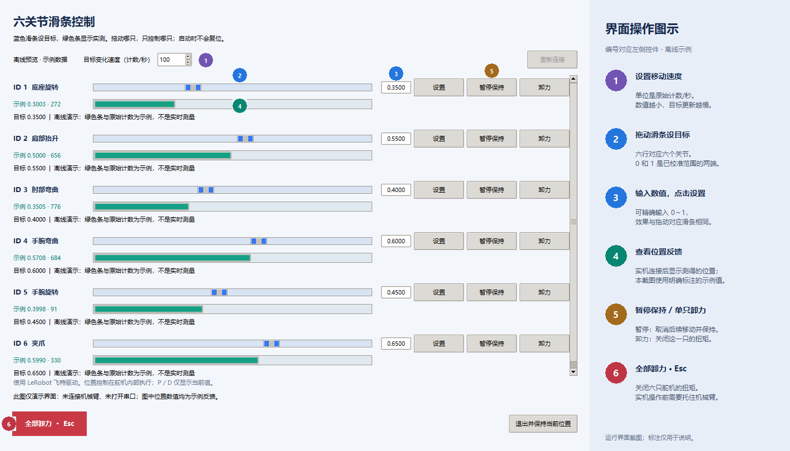

# SCS215 六关节机械臂：编号、校准与滑条控制

本作业通过串口连接六只 SCS215，将六个 0～1 数值映射到各关节的自定义运动范围。演示视频：[demo.mp4](demo.mp4)。

运行环境为 Windows、Python 3.12，使用 `lerobot` Conda 环境。已验证的依赖版本：`lerobot 0.6.2`、`pyserial 3.5`、`feetech-servo-sdk 1.0.0`；界面使用 Python 自带的 Tkinter。在本文件夹打开终端，先执行：

```powershell
conda activate lerobot
```

所有 Python 文件和 `calibration.json` 放在同一目录。已附本机械臂的最终校准结果，同一套硬件可直接进入第 4 步；下面是从头配置的流程。

## 1. 单只编号：set_id.py

每次只连接一只舵机，运行后输入目标编号 1～6。成功后断电换下一只，全部完成后再串联。

```powershell
python set_id.py
```

程序扫描当前编号，关闭扭矩、解锁 EEPROM、写入新 ID，再锁定并读回验证。编号及最终校准结果如下，位置单位为原始计数：

| ID | 关节     | 0 端 | 1 端 | 展开跨度 |
| -- | -------- | ---: | ---: | -------: |
| 1  | 底座旋转 |   57 |  773 |      716 |
| 2  | 肩部抬升 |  317 |  995 |      678 |
| 3  | 肘部弯曲 |  319 |  903 |      584 |
| 4  | 手腕弯曲 |  321 |  957 |      636 |
| 5  | 手腕旋转 |  400 |  976 |      576 |
| 6  | 夹爪     |   97 |  486 |      389 |

## 2. 连接检查：check_connection.py

串联六只舵机并通电，运行：

```powershell
python check_connection.py
```

程序逐个读取 ID1～ID6 的编号寄存器，检查应答编号、长度和校验和，输出连接结果，不发送运动指令。通信波特率为 1 Mbps，默认按转接板序列号识别串口；更换板子时，编号、校准及 GUI 程序可加 `--port COM9` 指定实际端口，连接检查程序则修改顶部的 `PORT`。

## 3. 两端点校准：calibrate.py

```powershell
python calibrate.py
```

固定底座并托住机械臂，按回车卸力。先把六个关节都摆到希望定义为 **0** 的位置，一次回车记录六个起点；再按 ID1～ID6 的提示，逐个摆到各自的 **1** 端并回车，此时其他关节的位置不影响当前端点记录。最后确认保存；覆盖已有文件需输入 `overwrite`。

程序采样检查位置稳定性，跟踪原始读数变化，保存起点、终点和展开跨度到 `calibration.json`。0/1 表示所选范围的两端，不是角度。目标换算为：

```text
目标原始位置 = round(起点 + 输入比例 × 展开跨度) % 1024
```

例如 ID6 输入 0、0.5、1，分别对应 97、292、486。2026-10-01 已同步最新重装结果，所有当前区间均不跨界；ID5 输入 0、0.5、1 分别对应 400、688、976，688 同时为其模型 0°。旧预设仅保留更新后的 Middle；提交视频与截图仍是此前演示。

## 4. 六滑条控制：control_arm_gui.py

```powershell
python control_arm_gui.py
```

启动时读取六个当前位置并初始化滑条，不先复位。拖动蓝色滑条，或输入 0～1 后点击“设置”，即可控制对应关节；绿色条显示实测位置。可连续调整多个关节，后台分别跟踪目标。

程序使用 LeRobot 的飞特驱动，按 SCS 大端字节序下发目标；串口线程限速更新位置，新的拖动目标替换旧目标。位置闭环由舵机内部完成，界面只读取 P/D 参数。首次控制会核对并清除旧窄硬件限位，软件目标仍受校准范围约束；检测到明显反向或持续停滞时，只卸力对应关节。

“暂停保持”停止该关节的后续移动；退出窗口保持已控制关节的当前位置；**Esc / 全部卸力**关闭六只扭矩，操作前托住机械臂。

下图为实际程序窗口的**离线预览截图**，未连接机械臂，位置数值均为明确标注的示例；实机运动见 [demo.mp4](demo.mp4)。[查看无标注 UI 截图](images/gui.png)。

编号 1～6 依次对应：速度、目标滑条、精确输入、位置反馈、单关节暂停/卸力、全部卸力。


