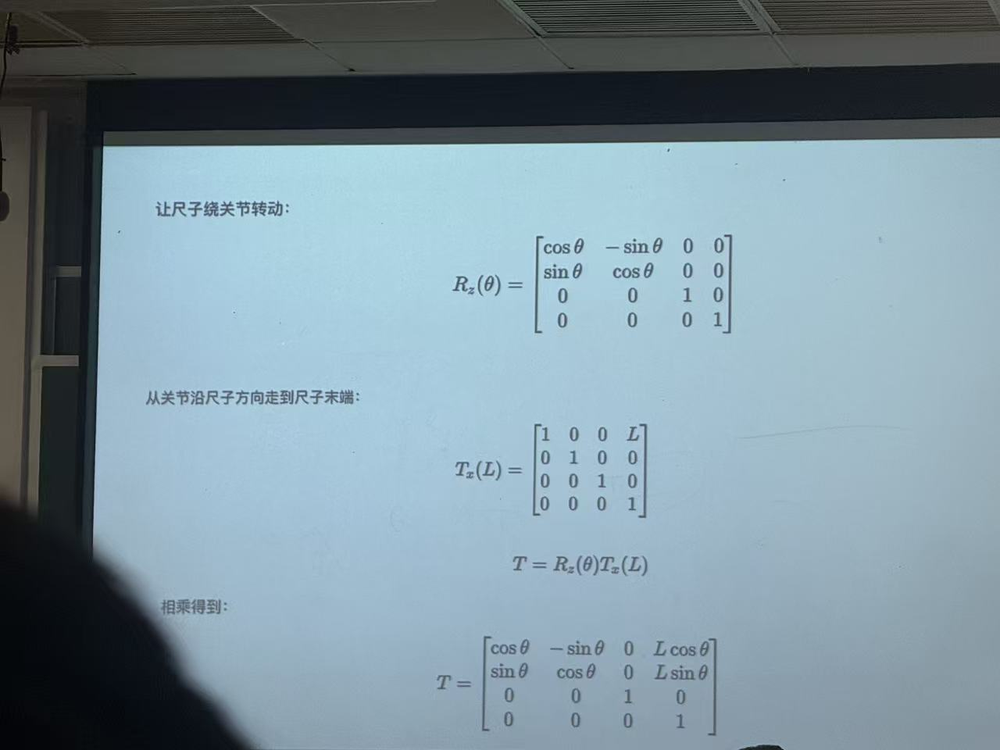
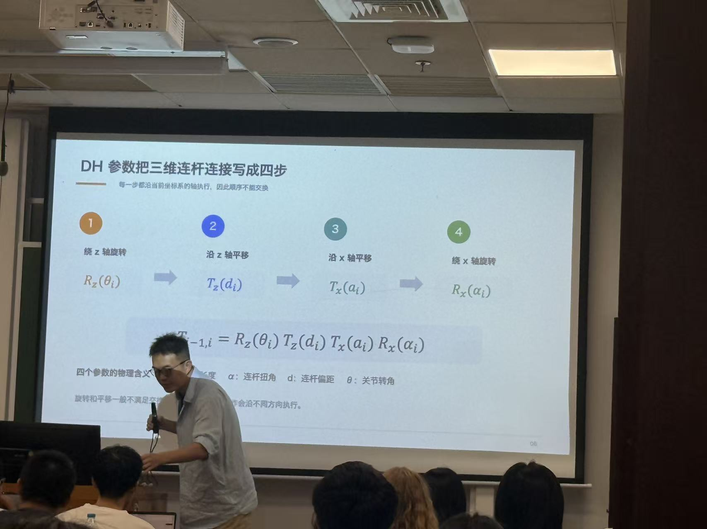

# Lec4 课堂笔记

## 正向运动学 Forward Kinematics

> 术语区分：根据关节角度或位移，计算末端的位置和姿态，叫**正向运动学（正运动学）**；根据关节力或力矩，结合质量、惯量等计算运动加速度，才是**正向动力学**。本节的 DH 参数属于运动学。

### 1. DH 参数描述什么？

**DH（Denavit–Hartenberg）参数用四个参数描述相邻两个连杆坐标系之间的位置和朝向关系。** 将每一节的变换串起来，就能根据关节状态算出机械臂末端的位置和姿态。

使用 DH 参数的前提是按规则建立坐标系，不能任意放置坐标系后直接套公式。以下采用课堂第二张图中的**标准 DH 约定**。

### 2. 第一张图：转动的尺子

假设尺子长 $L$，一端固定在关节上，在 $xy$ 平面内转动，转角为 $\theta$：

- 关节处为基坐标系原点，$z$ 轴垂直于运动平面，是关节转轴。
- 初始时尺子沿 $x$ 轴放置。
- 尺子末端放置一个随尺子一起转动的坐标系。

从关节坐标系构造末端坐标系，可以分成两步：

1. 绕 $z$ 轴旋转 $\theta$，使 $x$ 轴指向尺子方向。
2. 沿**旋转后的局部 $x$ 轴**平移 $L$，到达尺子末端。

因此：

$$
T=R_z(\theta)T_x(L)
=\begin{bmatrix}
\cos\theta&-\sin\theta&0&L\cos\theta\\
\sin\theta&\cos\theta&0&L\sin\theta\\
0&0&1&0\\
0&0&0&1
\end{bmatrix}
$$

这是一个 **$4\times4$ 齐次变换矩阵**：

$$
T=\begin{bmatrix}R&p\\0&1\end{bmatrix}
$$

其中，左上角的 $3\times3$ 矩阵 $R$ 表示末端坐标系相对于基坐标系的朝向；右上角的 $3\times1$ 向量 $p$ 表示末端原点在基坐标系中的位置；最后一行是 $[0,0,0,1]$。

所以尺子末端的位置为：

$$
\boxed{x=L\cos\theta,\qquad y=L\sin\theta,\qquad z=0}
$$

例如，$L=1\,\mathrm{m}$、$\theta=30^\circ$ 时，末端位置约为 $(0.866,\ 0.5,\ 0)\,\mathrm{m}$，末端坐标系也绕 $z$ 轴转了 $30^\circ$。

### 3. 第二张图：标准 DH 的四步变换

三维机械臂中，相邻关节轴可能有间距，也可能朝向不同，因此一般需要四步：

$$
\boxed{{}^{i-1}T_i
=R_z(\theta_i)\,T_z(d_i)\,T_x(a_i)\,R_x(\alpha_i)}
$$

这里 ${}^{i-1}T_i$ 表示坐标系 $i$ 相对于坐标系 $i-1$ 的位姿，也用于将点在坐标系 $i$ 中的齐次坐标转换到坐标系 $i-1$ 中。

| 参数 | 名称 | 变换操作 | 几何含义 |
| --- | --- | --- | --- |
| $\theta_i$ | 关节角 | 绕 $z$ 轴旋转 | 绕 $z_{i-1}$，从 $x_{i-1}$ 转向 $x_i$ 的角度 |
| $d_i$ | 连杆偏距 | 沿 $z$ 轴平移 | 沿 $z_{i-1}$，从原点 $O_{i-1}$ 到与 $x_i$ 相交处的有向距离 |
| $a_i$ | 连杆长度 | 沿 $x$ 轴平移 | 沿公法线 $x_i$，从 $z_{i-1}$ 到 $z_i$ 的距离 |
| $\alpha_i$ | 连杆扭角 | 绕 $x$ 轴旋转 | 绕 $x_i$，从 $z_{i-1}$ 转向 $z_i$ 的角度 |

建立坐标系时的关键规则：

- $z_{i-1}$ 沿第 $i$ 个关节的运动轴，即旋转轴或伸缩方向。
- $x_i$ 沿相邻轴 $z_{i-1}$ 和 $z_i$ 的公法线，即同时垂直于两根轴的方向；相交或平行时按相应的特殊情况选择。
- $y_i$ 按右手定则确定，转角的正方向也遵循右手定则。

**易混点：** $a_i$ 是按坐标轴定义的距离，不一定等于机械臂外壳那一节的实际长度；$\theta_i$ 描述绕关节轴的转角，$\alpha_i$ 描述相邻关节轴的相对倾斜。

### 4. 两张图的联系

第一张图是第二张图的简单特例。在尺子末端坐标系的 $z$ 轴与关节 $z$ 轴同向、且没有轴向偏移的设置下：

$$
a=L,\qquad d=0,\qquad\alpha=0
$$

代入标准 DH 公式：

$$
T=R_z(\theta)T_z(0)T_x(L)R_x(0)
=R_z(\theta)T_x(L)
$$

因为 $T_z(0)$ 和 $R_x(0)$ 都是单位矩阵，四步就简化成了第一张图的“旋转 + 平移”。

> **关于乘法顺序：** 图中的步骤是在逐步更新的局部坐标轴下构造坐标系，因此可以说“先转，再沿转后的轴平移”。当计算列向量 $\tilde p_{i-1}={}^{i-1}T_i\tilde p_i$ 时，矩阵对点的作用仍然从右往左计算。两种描述的对象不同，并不矛盾。旋转和平移一般不能随意交换顺序。

### 5. 从单节连杆到整个机械臂

对于有 $n$ 个关节的串联机械臂，为每一节列出 DH 参数、构造变换矩阵，再按顺序相乘：

$$
\boxed{{}^{0}T_n
={}^{0}T_1\,{}^{1}T_2\cdots{}^{n-1}T_n}
$$

结果给出末端坐标系相对于基座坐标系的位置和姿态。如果实际工具坐标系与第 $n$ 个坐标系不重合，还要继续乘上对应的工具固定变换。

| 关节类型 | 随运动变化的参数 | 由机械结构确定的参数 |
| --- | --- | --- |
| 旋转关节 | $\theta_i$（可能包含固定零位偏置） | $a_i,\alpha_i,d_i$ |
| 移动关节 | $d_i$（可能包含固定零位偏置） | $a_i,\alpha_i,\theta_i$ |

在具身智能的抓取任务中，DH 模型提供机械臂的几何基础：

- **正向运动学：** 已知各关节角度或位移，求夹爪的位置和姿态。
- **逆向运动学：** 已知夹爪期望的位置和姿态，求可行的关节角度或位移。

参考：[MathWorks：使用 DH 参数构建机械臂模型](https://www.mathworks.com/help/robotics/ug/build-manipulator-robot-using-kinematic-dh-parameters.html)。不同教材或软件也可能使用改进 DH 约定，其坐标系、下标和变换顺序可能不同，使用时需保持一致。

## 逆运动学 Inverse Kinematics, IK

已知$x,y$求若干个$\theta$