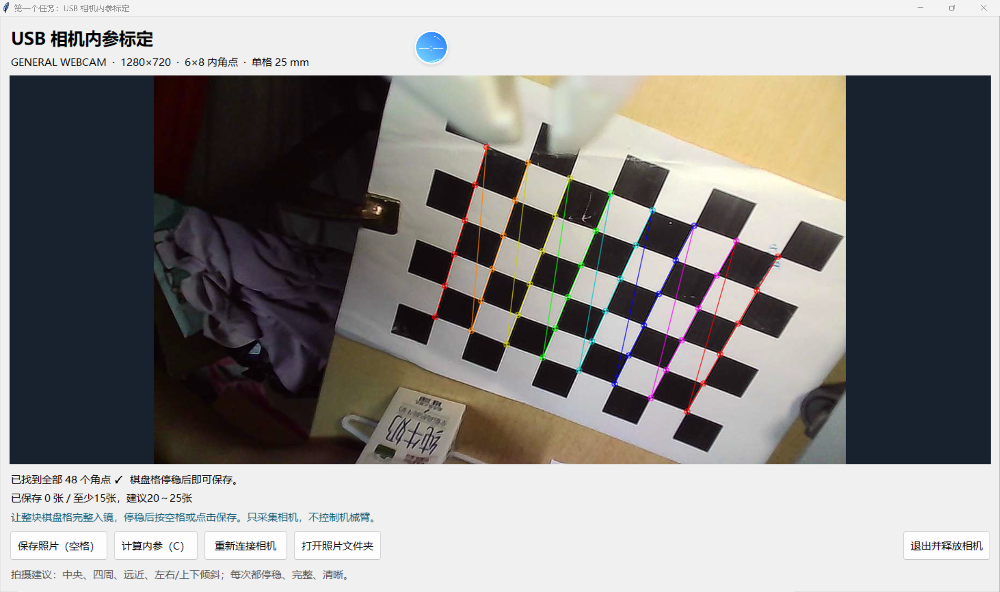
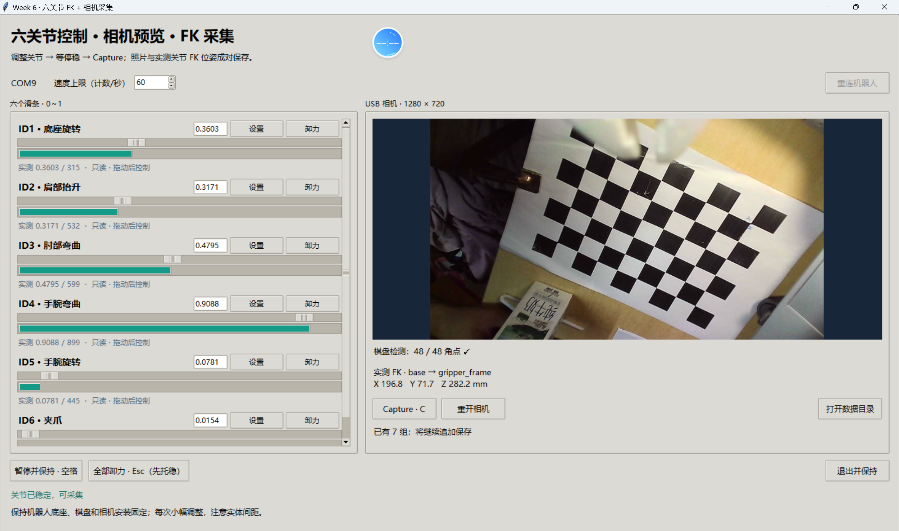

# EmbodiedAI Week 6 作业

## 1. 相机标定

主要文件：

- [标定程序](相机标定/calibrate_intrinsics.py)
- [启动脚本](相机标定/start_calibration.cmd)
- [相机内参结果](相机标定/intrinsics.json)
- [程序运行截图](相机标定/程序运行截图.png)

截图中程序使用 `GENERAL WEBCAM` 的 `1280 × 720` 画面，成功检测到棋盘的 `6 × 8 = 48` 个内部角点。棋盘单格边长为 25 mm，画面中的棋盘完整且角点顺序连续，可以用于保存标定图像。

32张有效图像得到的相机内参矩阵为：

$$
K=\begin{bmatrix}
1311.1459 & 0 & 668.2816\\
0 & 1308.2339 & 362.3693\\
0 & 0 & 1
\end{bmatrix}
$$

畸变系数为：

$$
[0.13163,\ -0.07457,\ 0.01728,\ -0.01685,\ -0.61067]
$$

重投影 RMS 为 **0.590 px**，符合重投影误差约为1 px的要求。

## 2. 手眼标定

主要文件：

- [采集界面](手眼标定/fk_hand_eye_gui.py)
- [FK与同步采集](手眼标定/fk_capture_core.py)
- [手眼标定计算](手眼标定/hand_eye_calibration.py)
- [合并数据评估](手眼标定/evaluate_combined_hand_eye.py)
- [棋盘原点验证](手眼标定/validate_current_board.py)
- [启动脚本](手眼标定/start_fk_hand_eye.cmd)
- [手眼标定结果](手眼标定/hand_eye_candidate.json)
- [完整计算报告](手眼标定/combined_hand_eye_report.json)
- [程序运行截图](手眼标定/程序运行截图.png)

截图中六个关节均已连接，程序同时显示相机画面和末端 FK 坐标，并完整检测到48个棋盘角点。标定共使用12个不同姿态，最终选用 DANIILIDIS 方法。

手眼矩阵为：

$$
T_{EC}=\begin{bmatrix}
0.997855 & 0.051047 & -0.040989 & 0.003422\\
-0.064896 & 0.853778 & -0.516577 & 0.082090\\
0.008626 & 0.518128 & 0.855259 & -0.099093\\
0 & 0 & 0 & 1
\end{bmatrix}
$$

它满足 $p_E=T_{EC}p_C$：将相机坐标系中的点转换到末端执行器坐标系。左上角的 $3\times3$ 矩阵描述相机相对于末端的旋转，最后一列描述相机原点在末端坐标系中的位置。

棋盘原点在底座坐标系中：

- $X=34.21\text{ cm}$
- $Y=19.46\text{ cm}$
- $Z=5.99\text{ cm}$

1. 底座原点到棋盘原点的直线距离：**39.81 cm**
2. 相机原点在末端坐标系中：
   - $X=0.34\text{ cm}$
   - $Y=8.21\text{ cm}$
   - $Z=-9.91\text{ cm}$
3. 相机原点到末端原点的距离：**12.87 cm**

实体测量结果与估计结果在各坐标轴上的误差均在 **5 cm** 以内。

## 3. 视觉伺服

主要文件：

- [视觉伺服界面与机器人控制](视觉伺服/aruco_visual_servo_gui.py)
- [ArUco检测与坐标转换](视觉伺服/aruco_visual_servo_core.py)
- [完整模式启动脚本](视觉伺服/start_aruco_visual_servo.cmd)
- [仅观察模式启动脚本](视觉伺服/start_aruco_observe_only.cmd)
- [演示视频](视觉伺服/演示视频.mp4)

演示视频：**[点击查看](视觉伺服/演示视频.mp4)**

程序检测 `DICT_4X4_50` 中的 ID 0 ArUco 码，黑色方块边长为5 cm。画面在水平和垂直方向划分为 `40% / 20% / 40%`：目标位于左、右、上、下区域时，相机向对应方向移动1 cm；目标进入中央区域后，相机沿光轴向前移动1 cm。

每次图像决策得到相机坐标系位移 $\Delta p_C$，程序利用当前 FK 和手眼矩阵计算：

$$
\Delta p_B=R_{BE}R_{EC}\Delta p_C
$$

得到底座坐标系中的移动方向，再调用上节课的IK与轨迹控制程序执行。每移动1 cm后重新检测目标，构成闭环；程序同时提供单步、连续、最大步数、停止保持和实体标定误差确认功能。
