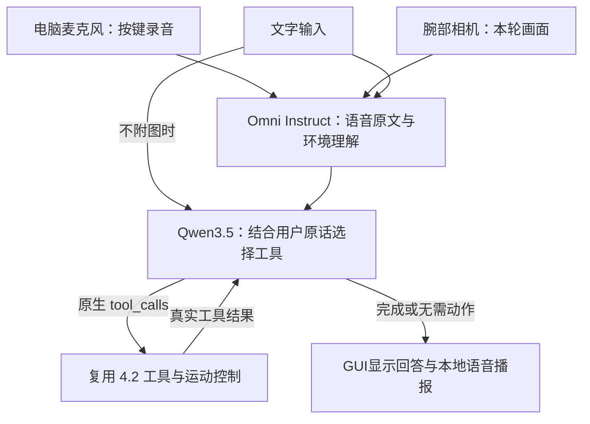

# 4.3 视觉语音机械臂 Agent

采用两个模型：**Qwen3-Omni-30B-A3B-Instruct** 理解语音和画面，**Qwen3.5-4B** 选择工具并组织回答。运动、标定和追踪直接复用相邻 `4_2` 的实现，未另写 IK，也未新增运动幅度限制。

## 运行

在本目录打开 PowerShell：

```powershell
# 模拟相机和机械臂，调用真实模型；电脑没有连接机器人时使用
& D:\miniconda\envs\lerobot\python.exe .\gui.py

# 回家连接机械臂和腕部相机后使用
& D:\miniconda\envs\lerobot\python.exe .\gui.py --real

# 完全离线演示：不调用API、不连接硬件，只支持预设文字指令
& D:\miniconda\envs\lerobot\python.exe .\gui.py --offline --mute
```

## 窗口用法

- **语音**：选择电脑麦克风 →“开始录音”→说出指令 →“结束录音并发送”。右侧显示语音原文、环境理解和模型回答。“载入WAV测试”可使用已有录音。
- **文字**：底部输入并发送，或点击快捷按钮。勾选“附带当前画面”时同样经过 Omni；取消勾选的文字直接发给工具调用模型。
- **画面**：真机模式沿用 4.2 的腕部 `GENERAL WEBCAM` 及标定文件；模拟模式显示合成 ArUco。预览等比例缩放到固定布局区域，不会逐帧撑大窗口。
- **播报**：使用 Windows 本地语音合成，可取消“语音播报”。这不是 Omni 生成的音频。
- **停止**：按钮或 Esc 请求停止当前动作、追踪及后续工具调用。网络请求可能仍需等待返回或超时，返回后不会继续执行已取消的动作。
- **退出**：点“退出并释放设备”或窗口关闭按钮，关闭相机、录音和播报；真机沿用 4.2 的退出卸力流程。

模拟模式的**相机和机械臂**是模拟的，麦克风和 API 可真实使用。普通物体支持观察和描述；连续追踪仍只支持 ArUco，不具备任意物体三维抓取功能。

## 流程



六个工具：`get_robot_state`、`detect_object`、`start_tracking`、`stop_tracking`、`ik_move`、`fk_move`。

## 示例用法

部分示例用法如下

| 用途 | 可以说的指令 |
|---|---|
| 查询状态 | “查看机械臂当前状态。” |
| 查看环境，勾选“附带当前画面” | “描述一下你现在看到的画面，不要移动机械臂。” |
| 检测标记 | “检测 ArUco 0，告诉我它的位置和距离，先不要追踪。” |
| 开始视觉伺服 | “追踪 ArUco 0，让它居中，距离保持20厘米。” |
| 停止追踪 | “停止追踪。” |
| IK 位移 | “末端向上移动1厘米。” |
| FK 姿态 | “回到 middle 姿态。” |
